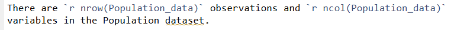

**Section 1: Loading libraries**
Four libraries have been loaded for this assignment.

```{r libraries, include=FALSE}
library(knitr)
library(tidyverse)
library(ggrepel)
library(readxl)
```

**Section 2: Research question**

What is the trend in Australia's population growth and median age over time? What is the relationship between median age and population growth across various countries?

**Section 3: Dataset introduction**

The dataset used for this assignment is age and population data for selected countries, from 1950 to 2023. This dataset is a subset of a larger dataset (containing all countries, and more population and migration variables), available from the [World Population Prospects 2024](https://population.un.org/wpp/downloads?folder=Standard%20Projections&group=Most%20used) website. The specific excel file is linked [here.](https://population.un.org/wpp/assets/Excel%20Files/1_Indicator%20(Standard)/EXCEL_FILES/1_General/WPP2024_GEN_F01_DEMOGRAPHIC_INDICATORS_COMPACT.xlsx).

Due to dataset restrictions for this assignment (1000 records), only 13 countries were selected for use in the final dataset. Australia, the United States, the United Kingdom, plus the ten largest countries in the [United Nations Economic and Social Commission for Asia and the Pacific (ESCAP)](https://www.unescap.org/about/member-states). The United States and United Kingdom were selected as comparable first world democracies to Australia, while the ESPAC countries were chosen due to being geographically in a similar economic region as Australia.

The final dataset includes 5 variables: Country name; Year; Population size; Population growth rate; and median age. 


```{r variable names, include=TRUE}
Population_data<-read_excel("Data/Population data.xlsx") |>
  
  rename(
    Country = `Region, subregion, country or area`,  #rename variables for simplicity
    Population_thousands = `Total Population, as of 1 July (thousands)`,
    Median_age = `Median Age, as of 1 July (years)`,
    Population_growth_rate_percent = `Population Growth Rate (percentage)`
  )

knitr::kable(
  data.frame(
    Variable = names(Population_data),
    check.names=FALSE
  ),
  caption = "Table 1: Variables in the Population_data dataset")
```

**Section 4: Dataset description**

There are `r nrow(Population_data)` observations and `r ncol(Population_data)` variables in the Population dataset.

```{r Number of variables and observations (inline r code), echo=TRUE}

str(Population_data,vec.len = 2)
```

**Section 5: Data summary**

```{r Summary, echo=TRUE}
Population_data_summary <- Population_data |>
  group_by(Country) |>
  
  summarise(
    Ave_Median_age = mean(Median_age), 
    Ave_Population_growth_rate_percent = mean(Population_growth_rate_percent)
  ) |>
  
  arrange(Ave_Median_age)

knitr::kable(
  head(Population_data_summary,10),
  caption = "Table 2: Summary by age and growth rate") 
```
The summary above shows that of the reported countries, from 1950 to 2023, **Pakistan** has the lowest average median age, and the highest average growth rate, while **Australia** has a relatively high median age and low growth rate. There appears to be a general trend of average median age increasing as average population growth rate decreases (negative relationship).

**Section 6: Visualisations**

```{r Visualisation, echo=TRUE, fig.cap="This chart shows the relationship (in 2023) between median age of a country, and its population growth, with size of dots indicating the population size of the country."}

Population_data |>
  filter(Year==2023)|>
  
  ggplot(
    aes(
      x = Population_growth_rate_percent, 
      y = Median_age, 
      size = Population_thousands
      )
  ) +
  
  geom_point()+
  
  scale_size_continuous(
    breaks=seq(100000,700000,by = 200000),
    labels = scales::comma
  ) +
  
  geom_text_repel(
    aes(label = Country),
    size = 3,
    point.padding = 0.9,               
    segment.color = "grey50"
    ) +
  
  labs(
    title = "Chart 1: Relationship between age and population growth, 2023",
       x = "Population growth rate (%)",
       y = "Median age",
       size = "Population (thousands)"
  )
```

* *There is a negative relationship between the median age and population growth rate of the selected countries.*
* *There appears to be no strong correlation between population size (represented by the size of the dots) and either median age or population growth rate, based on this data.*


```{r Visualisation2, echo=TRUE}

Population_data |>
  filter(Country=="Australia")|>
  ggplot(aes(x = Year))+
  
  geom_line(
    aes(y = Median_age, 
        colour = "red"), 
    linewidth = 0.7
    ) +
  
  geom_line(
    aes(y = Population_growth_rate_percent*8, 
        colour = "blue"), 
    linewidth = 0.7, 
    linetype="dashed"
    ) +

  geom_text_repel(
  data = Population_data |>
    filter(Country == "Australia",Year == max(Year)),
  aes(
    y = Population_growth_rate_percent, 
    label = "Annual population growth (%)"
    ),
  direction = "y",
  colour = "red",
  point.padding = 1,
  nudge_y = 1
) +
  
  geom_text_repel(
  data = Population_data |>
    filter(Country == "Australia",Year == max(Year)),
  aes(
    y = Median_age, 
    label = "Median age"
    ),
  direction = "y",
  colour = "blue",
  point.padding = 1,
  nudge_y = 1
) +
  
theme_minimal() +
  
scale_y_continuous(
    name = "Median age",
    limits = c(0,50),
    sec.axis = sec_axis(
      ~ ./8,name = "Annual population growth (%)"
      )
    )+
    theme(
      legend.position = "none"
    )+
labs(
    title = "Chart 2: Median age and annual population growth in Australia, 1950 to 2023"
)
```
* *This chart shows the median age of Australia's population, along with the annual population growth rate, from 1950 to 2023.*
* *Since around 1970, Australia's median age has gradually increased. Meanwhile, Australia's annual population growth rate has declined from 1950 to 2023, although it has also fluctuated during this time.*

```{r Summary2, echo=TRUE}
Population_data_summary2 <- Population_data |>
  filter(Year %in% c(1950, 2023))|>
  pivot_wider(
    names_from = Year,
    values_from = c(
      Population_thousands, 
      Median_age, 
      Population_growth_rate_percent
      )
  )|>
  mutate(
    Median_age_diff = Median_age_2023 - Median_age_1950,
    Pop_growth_diff = Population_growth_rate_percent_2023 - 
                      Population_growth_rate_percent_1950
    )|>
  select(
    Country, 
    Median_age_diff, 
    Pop_growth_diff
    )|>
  arrange(Median_age_diff)

knitr::kable(
  head(Population_data_summary2,13),
  caption = "Table 3: Changes in median age and population growth rates from 1950 to 2023"
  ) 
```
* *This table shows that the trend we see for Australia (i.e. a declining growth rate and increasing median age from 1950 to 2023) has occurred across all the selected countries to various degrees. Australia ranks towards the middle of the 13 reported countries in its change over this time. Japan is a notable outlier with a very large increase of 27.6 years in median age, and a reduction of 2.2 percentage points in annual population growth rate.*


**Section 7: Conclusion**

Australia's median age has been increasing over time, at least since 1950. Meanwhile, Australia's annual rate of population growth has declined overall since 1950, although has fluctuated over this time. These trends are broadly reflected in other countries in Asia-Pacific region, and for similar first-world economies including the United States and the United Kingdom.

There is a strong negative relationship between the median age of a country, and its annual population growth. That is, the higher the median age of a country, the lower its annual population growth is likely to be on average.

These trends suggest that many countries, Australia included, are facing the challenges of an ageing population, and that declining population growth rates may be exacerbating these challenges as there may be insufficient people to support the economy and look after the elderly. Japan stands out as an outlier in the data with a particularly high median age, and negative population growth rate in recent years. According to the World Economic Forum, these challenges are already having [significant impacts](https://www.weforum.org/stories/health-and-healthcare-systems/elderly-oldest-population-world-japan) on many facets of Japanese society.

These conclusions are based on analysis of data from 13 countries including Australia. To strengthen these findings, further analysis could be conducted on a wider array of countries from various continents. In addition, breakdowns of population growth by natural increases versus migration-related increases would add further insight. 


